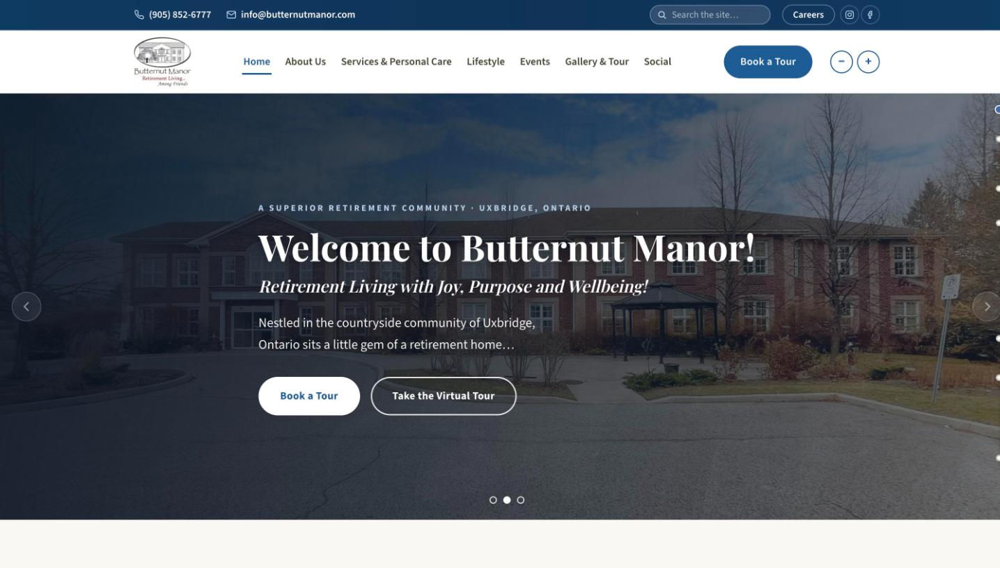
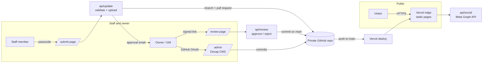
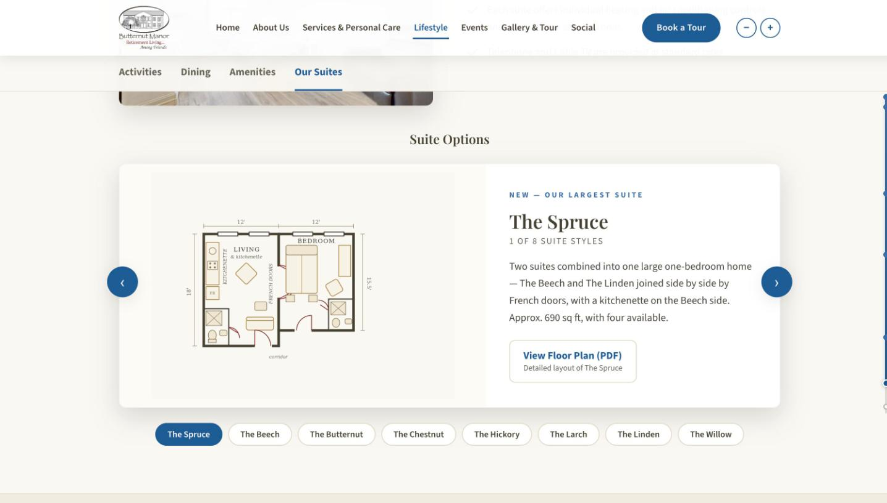
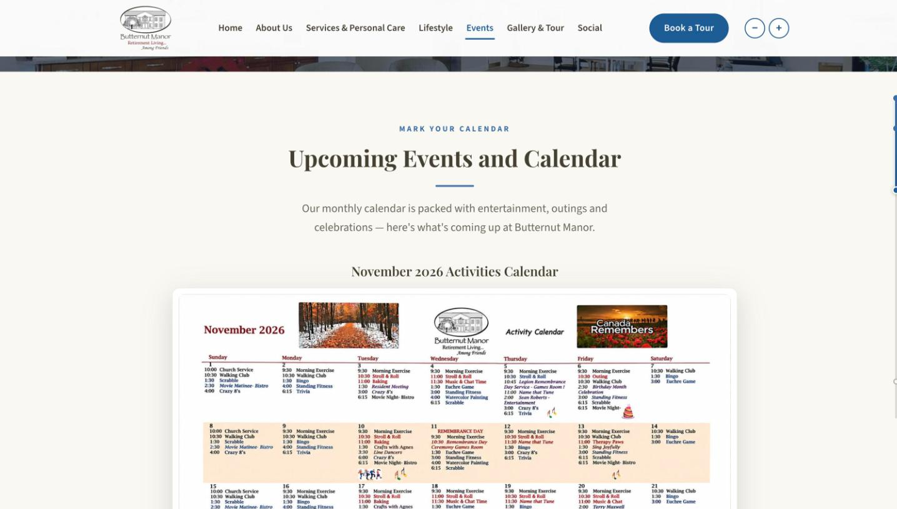

# Retirement Residence Web Platform

**Production websites for two Ontario retirement residences, with a staff publishing workflow that keeps the owner in control of every change.**

[](https://butternutmanor.ca)


> This is a public case study. The production source code lives in a private repository owned by the business.
> The `excerpts/` folder contains selected, cleaned-up pieces of the real implementation so that the engineering can be reviewed without publishing the full site.



## At a glance

| | |
|---|---|
| **Residences** | Butternut Manor Retirement Home (Uxbridge, ON) and Queens Village for Seniors (London, ON) |
| **Role** | Web Developer, paid engagement (May 2026 to present). Product owner and technical lead |
| **Live** | [butternutmanor.ca](https://butternutmanor.ca) (in production since Nov 4, 2026) |
| **Replaced** | A legacy WordPress site |
| **Users** | Residents' families and prospective residents (public), the owner and general manager (content approval), front-line staff (content submission) |
| **Scale** | 9 public pages, 5 serverless functions, 8 interactive floor plans, ~36 photos, a 1:54 virtual tour built from 27 photos |

## The problem

The residence ran on an outdated WordPress site that staff could not update safely. Activity calendars and event flyers change every month, and the people who produce them (activities staff) are not the people who should decide what goes live (the owner). The brief had three non-negotiable constraints:

1. **Staff propose, the owner approves.** Nothing reaches the public site without an explicit approval.
2. **Zero hosting cost.** Free tiers only (GitHub Free, Vercel Hobby), with a private repository.
3. **No technical skills required** from staff or the owner, on any device.

## What I built

- **A fast, accessible marketing site** in plain HTML, CSS and JavaScript (no framework, no build step), with a fuzzy site search, adjustable page zoom for older readers, an interactive suite floor-plan carousel, a filterable gallery with lightbox, and a virtual tour video.
- **A data-driven Events page.** The monthly calendar and event flyers are read from one JSON file. The current month shows automatically, future months appear as tabs, past months retire on their own, and dated flyers hide the day after the event. Nobody has to remember to take anything down.
- **An owner-friendly CMS** (`/admin`) using Decap CMS with a GitHub backend, behind GitHub OAuth handled by two serverless functions.
- **A staff publishing workflow** (`/submit` then `/review`): staff upload a calendar, flyer or photo behind a passcode, the system opens a pull request and emails the approvers a signed, expiring review link, and one tap publishes or rejects. Publishing is a real git commit, which means every change is versioned and reversible.
- **A social feed** that pulls Instagram and Facebook posts through the Meta Graph API, cached at the edge and refreshed weekly by a cron job, with a static fallback.
- **A safe migration** from WordPress: 308 redirects for every old URL and legacy PDF path, a sitemap, canonical tags, security headers, and a DNS cutover with no downtime.
- **A second site** for Queens Village for Seniors, built in the same format with its own theme and a 360-degree virtual tour viewer with 9 stops.

## Architecture



More detail: [docs/architecture.md](docs/architecture.md) and [docs/staff-publishing-workflow.md](docs/staff-publishing-workflow.md).

## Engineering decisions worth discussing

| Decision | Why |
|---|---|
| **Approval through a bot-opened pull request, not branch protection** | Branch protection on a private repository requires a paid GitHub plan. A server-side function that can only *propose* (open a branch and pull request) gives the same guarantee for free: staff never hold write access to `main`. |
| **Publish by rebuilding on the current `main`, then fast-forwarding** | Two pending updates that both touch the events file would otherwise conflict. Each approval creates one new commit on top of whatever is live, and retries if `main` moved in the meantime ([excerpt](excerpts/publish-with-retry.js)). |
| **Signed, expiring review links instead of approver accounts** | The owner approves from an email on her phone. Each link is an HMAC-signed token naming exactly one submission, valid for 30 days, compared in constant time ([excerpt](excerpts/signed-review-links.js)). |
| **Plain HTML, no framework** | The site has to be maintainable for years by whoever comes next, load fast on older devices, and deploy with no build step. |
| **Dated content instead of manual cleanup** | Calendars and flyers expire on their own based on their dates ([excerpt](excerpts/events-schedule.js)), which removes the most common source of stale information on small-business sites. |
| **A pre-commit site checker** | A Python script runs on every commit and blocks broken links, pages missing from the navigation or search index, and internal files that would be served publicly. |

## Problems I diagnosed in production

- **CMS loaded a blank page.** Decap looked for its config at the wrong path; the fix was an explicit config link in the admin page.
- **Every animation silently disappeared on one machine.** Traced to the operating system's Reduce Motion setting being honoured by the stylesheet.
- **Deploys stopped triggering.** The Vercel Hobby plan only deploys commits authored by the project owner, which shaped how the publishing function authors its commits.
- **Internal files were reachable on the live site.** Added a deploy ignore list and verified each path returns 404.

## Results

- Live in production on the residence's own domain since **November 4, 2026**, approved by the owner and general manager.
- The owner manages content herself through `/admin`; staff updates go through `/submit` with owner approval.
- Delivered through **5+ feedback rounds with 5 stakeholders**, from the owner and general manager to activities staff.

## Screenshots

| Home | Suites and floor plans | Events |
|---|---|---|
|  |  |  |

## Repository contents

```
docs/
  architecture.md               how the site, functions and hosting fit together
  staff-publishing-workflow.md  the submit, review and publish flow, step by step
  decisions.md                  the key decisions and the options that were rejected
excerpts/                       selected code from the private repository (cleaned, not runnable on its own)
screenshots/                    images of the live sites
```

## Tech

HTML, CSS, JavaScript (ES modules), Node.js serverless functions on Vercel, GitHub REST API (git data API, pull requests), Decap CMS, GitHub OAuth, Meta Graph API, HMAC-signed tokens, Python (site checker, calendar rendering), Playwright, ffmpeg.

## How this was built

I use Claude as a working part of my development process. I was product owner and technical lead: requirements, stakeholder feedback, every account and configuration (GitHub, Vercel, OAuth, environment variables, tokens), deploys and live testing. Claude wrote and debugged code under my direction, and I reviewed and tested every change before it shipped.
