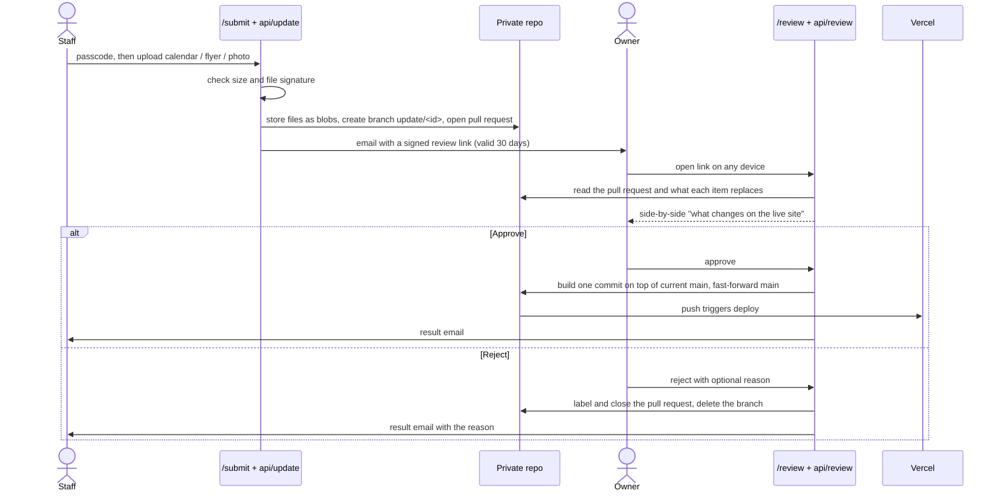

# Staff publishing workflow

The owner wanted staff to be able to post the monthly activities calendar, event flyers and photo updates without being able to change the public site themselves. This is the flow that delivers that on free tiers.

## Why it is built this way

**Staff can only propose.** The function behind `/submit` can create a branch and open a pull request. It cannot move `main`. The only code path that changes the live site is the approval in `api/review`, which requires a valid signed link.

**No conflicts between pending updates.** If two calendars are waiting, approving the second one must not undo the first. On approval the function reads the *current* `main`, applies the change to that version of `events.json`, creates one commit, and fast-forwards `main`. If `main` moved during that window, GitHub rejects the update and the function rebuilds and retries (up to 4 times).

**GitHub still shows a merged pull request.** The pull request branch is pointed at the final commit before `main` is fast-forwarded, which makes GitHub record the pull request as merged and keeps the history readable.

**Approvers need no account.** Approval happens through a link in an email. The token inside it names exactly one pull request and an expiry, and is signed with a server-side secret.

**Every change is reversible.** Because publishing is an ordinary commit, any update can be reverted from the repository history.
